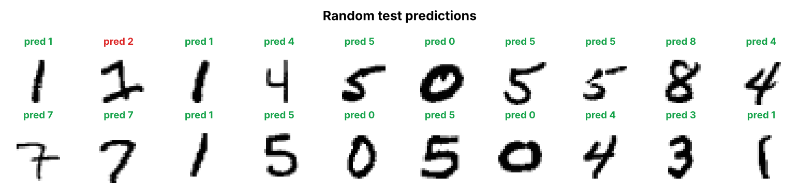
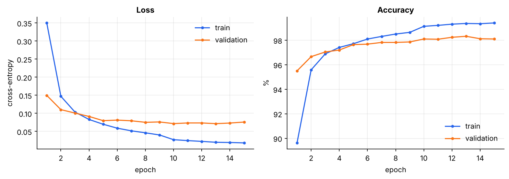
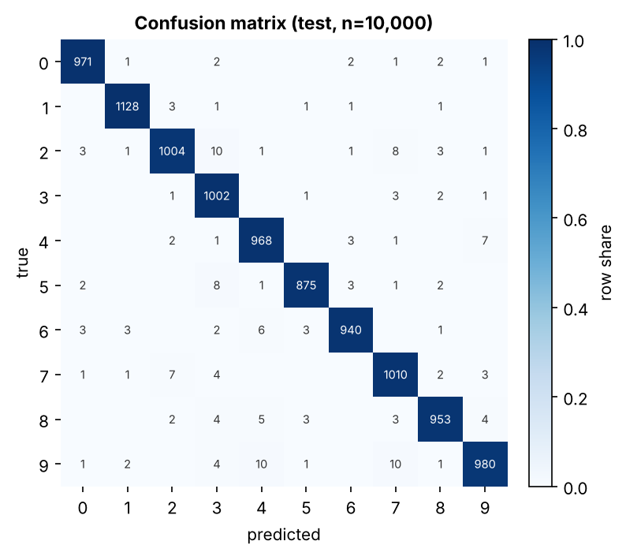
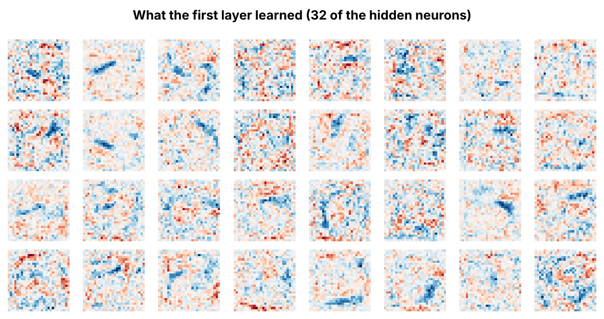
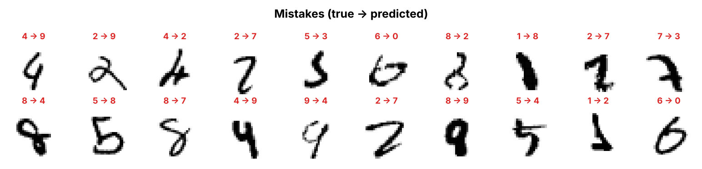
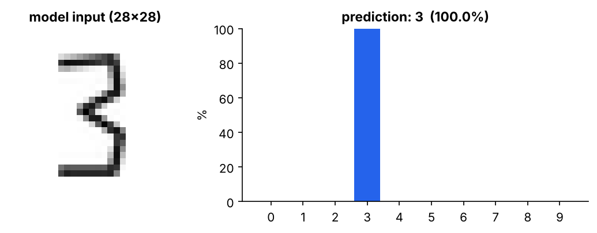

# Neural Network from Scratch — Handwritten Digit Recognition

A fully connected neural network built with **NumPy only** — no TensorFlow, no PyTorch.
Forward pass, backpropagation, Adam optimiser, dropout and the image preprocessing
pipeline are all implemented by hand, then trained on MNIST to recognise handwritten digits.


<p align="center">
  
</p>

## Results

| | |
|---|---|
| **Test accuracy** | **98.31 %** (10,000 unseen images) |
| Architecture | 784 → 256 → 128 → 10 (ReLU, dropout 0.2) |
| Parameters | 235,146 |
| Optimiser | Adam, lr 1e-3, halved after 60 % of training |
| Training time | ~45 s on a laptop CPU (15 epochs) |

<p align="center">
  
</p>

The confusion matrix shows which digits get mixed up most: 4 ↔ 9, 2 → 3, 9 → 7 and 7 → 2, which are exactly the pairs that look alike in handwriting.

<p align="center">
  
</p>

## What the network learned

Each of the 256 neurons in the first layer has 784 weights, one per pixel. Reshaping them back
to 28×28 shows the stroke patterns each neuron responds to (blue = excites, red = inhibits):

<p align="center">
  
</p>

And the mistakes it still makes. Many of them are hard for humans too:

<p align="center">
  
</p>

## Try it on your own handwriting

Write a digit on paper (or draw one in Paint), take a photo and run:

```bash
python predict.py my_digit.png --show
```

A raw photo looks nothing like MNIST, so `preprocess_image()` reproduces the original
dataset's preparation steps:

1. **Grayscale + invert:** MNIST digits are white on black
2. **Threshold:** removes paper texture and shadows
3. **Crop** to the digit's bounding box
4. **Resize** so the longest side is 20 px, keeping the aspect ratio
5. **Centre by centre of mass** in a 28×28 frame

<p align="center">
  
</p>

## How it works

```
input (784) ─► Dense ─► ReLU ─► Dropout ─► Dense ─► ReLU ─► Dropout ─► Dense ─► Softmax ─► 10 classes
                256                         128                          10
```

| Component | File | Key idea |
|---|---|---|
| Dense layer | `nn/layers.py` | `y = xW + b`, He initialisation; backward computes `∂L/∂W = xᵀ·δ` |
| ReLU | `nn/layers.py` | passes gradient only where the input was positive |
| Dropout | `nn/layers.py` | inverted dropout, active only during training |
| Softmax + cross-entropy | `nn/layers.py` | fused, so the gradient is simply `(p − y) / N` |
| Adam / SGD + momentum | `nn/optim.py` | Adam with bias correction |
| Model, save/load | `nn/model.py` | Sequential container, weights stored in `.npz` |

### Verifying backpropagation

`tests/test_gradients.py` compares every analytic gradient against a numerical estimate
from finite differences, `(L(w+ε) − L(w−ε)) / 2ε`. They agree to a relative error below 1e-5,
which confirms the backward pass is mathematically correct.

```bash
python -m pytest -q
```

## Getting started

```bash
git clone https://github.com/senadogan23/neural-network-from-scratch.git
cd neural-network-from-scratch
pip install -r requirements.txt

python train.py          # downloads MNIST (~11 MB) once, trains, saves figures to outputs/
python predict.py examples/seven.png --show
```

Experiment with the hyperparameters:

```bash
python train.py --hidden 512 256 --epochs 20 --dropout 0.3
python train.py --optimizer sgd --lr 0.05
```

## Project structure

```
├── nn/
│   ├── layers.py        # Dense, ReLU, Dropout, Softmax + Cross-Entropy
│   ├── optim.py         # SGD with momentum, Adam
│   └── model.py         # Sequential model, save / load
├── data_utils.py        # MNIST loader + image preprocessing pipeline
├── train.py             # training loop, validation, checkpointing
├── predict.py           # predict a digit from your own image
├── plots.py             # all figures in this README
├── tests/               # gradient checks
├── examples/            # sample digit images
└── assets/              # figures used in this README
```

## What I learned

- How backpropagation applies the chain rule layer by layer, and why the fused softmax + cross-entropy gradient is so simple
- Why initialisation matters: He initialisation keeps signals from vanishing through ReLU layers
- Using a separate validation set for model selection, so the test set stays a true holdout
- That most real-world errors come from **data mismatch**, not the model, which is why the preprocessing pipeline is half of the project

## Next steps

- [ ] Convolutional layer implemented from scratch
- [ ] Data augmentation (small rotations and shifts)
- [ ] Interactive drawing demo with Streamlit

## License

MIT © Sena Doğan
